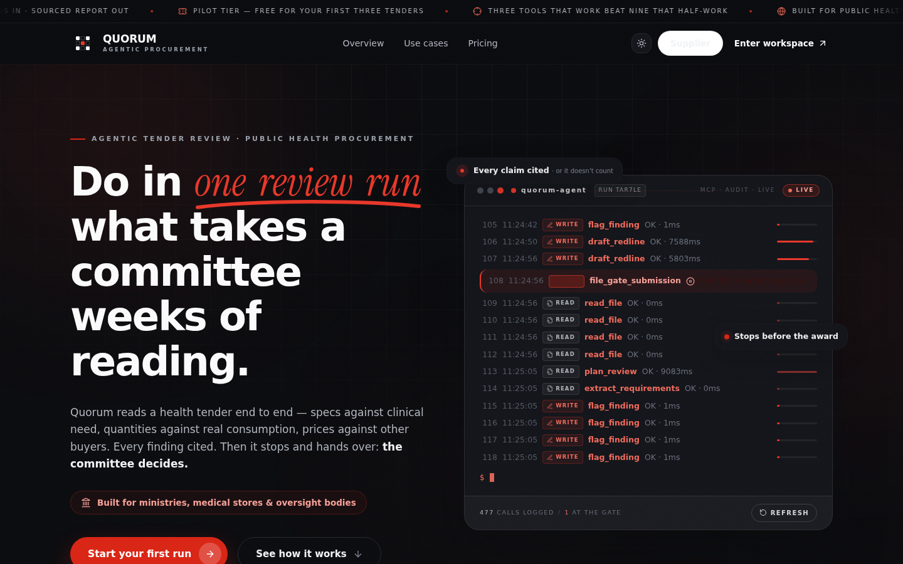
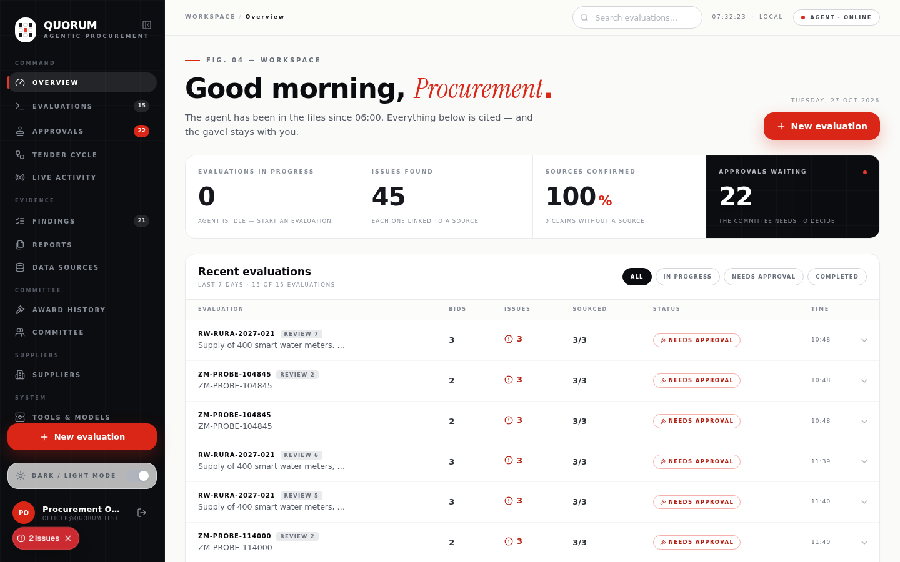
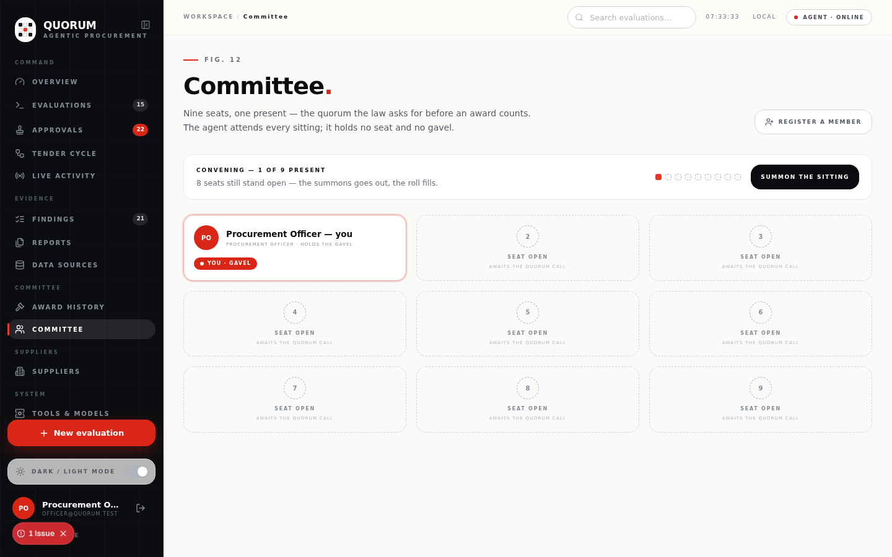
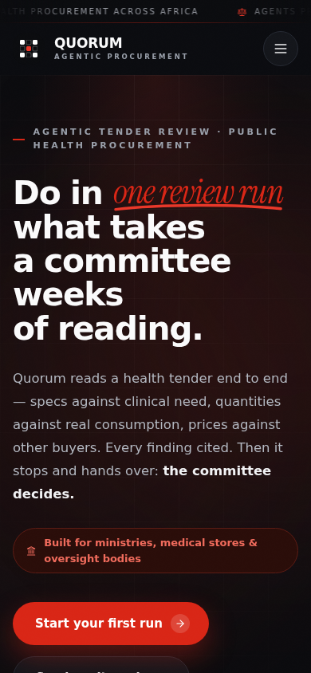

# Quorum — AI-assisted public procurement operations

[](https://m8ven.ai/mcp/chama18-quorum-5uxqrc?s=readme)

**The agent prepares the file. The committee awards the tender.**

Quorum is a procurement workspace for public institutions. It supports the tender file
from planning and document intake through evaluation, award controls, contract
administration and complaints. An agent reads supported tender documents, produces
evidence-linked findings and drafts committee redlines. People retain authority over
statutory and irreversible decisions: the review graph stops at a named-human gate, and
the filing path checks the user's session, committee roster, office, quorum and step-up
requirements before it can execute.

**Product:** [Live workspace](https://d1n7mv5t5hn4xe.cloudfront.net) ·
[Landing page](https://quorum-solutions.com) ·
[API directory](https://d1n7mv5t5hn4xe.cloudfront.net/api) ·
[Product documentation](https://d1n7mv5t5hn4xe.cloudfront.net/docs) ·
[MCP implementation](SUBMISSION/06-mcp-implementation.md)

**Core capabilities**

- Tender review with deterministic procurement rules, source citations, model-drafted
  redlines, a human gate and a downloadable sourced report.
- Tender-cycle workspace for pipeline planning, clarifications and addenda, bid opening,
  evaluation, award and standstill, contract records, payments, variations and complaints.
- Supplier portal, committee and meeting records, oversight, role-based access, audit
  export, notifications, support requests and a read-only desk assistant named Barry.
- REST and MCP interfaces with authenticated access controls. The requisition-validation
  endpoint uses a distributed Redis limit and fails closed when its Redis configuration
  is unavailable.

**Models:** Muse Spark 1.3 on Meta Model API is the hosted planning and drafting path;
Llama 3.2 through Ollama is the in-region fallback; deterministic templates remain the
last fallback. Hosted evidence is redacted before it leaves the desk. SAM 3.1 can locate
regions on scanned pages for human inspection; it does not read the page or verify
signatures.

**Data reality:** the KEMSA example is a real public award register with 11 awards, but
does not contain bid line items or quantities. The remaining sample bid packs are
synthetic. The e-GP transmission is simulated; no live national e-GP filing connector is
claimed. See [Limitations](#limitations) for the boundaries and evaluation status.

| | |
|---|---|
|  |  |
|  |  |

**Judge's 5-minute path:** open the [live app](https://d1n7mv5t5hn4xe.cloudfront.net)
→ sign in with the seeded judge account (`judge@quorum.test` / `Gatekeeper#2026`, verified,
no email needed) → run the KEMSA pack → read the sourced report → watch the agent halt at
the gate; signing without a fresh step-up is refused **403**.

**Try it in one command:** `bash scripts/judge-demo.sh` — boots the stack, seeds a
verified officer, launches a real review run over a demo tender pack, waits for the
agent to halt itself at the human-signature gate, then replays the unsigned-mutation
refusal as proof the agent cannot file.

## Desktop downloads

The Windows and macOS downloads on the landing page are Electron desktop shells for
the hosted Quorum workspace. They keep the web workspace in a dedicated, isolated
window and require an internet connection. Version tags (`v*`) build a portable Windows
x64 portable app bundle and a universal macOS disk image with Codemagic.
Build artifacts are also retained on each Codemagic build. To publish permanent
GitHub Release downloads, add a repository-scoped GitHub token with
**Contents: read and write** permission as the
`GITHUB_TOKEN` secret in the `github_credentials` Codemagic variable group before
creating a version tag.

The current desktop packages are unsigned. macOS will require the user to approve
opening an app downloaded outside the App Store until Developer ID signing and
notarization credentials are configured in Codemagic.

---

## Meta Global AI Developer Hackathon 2026

- **Theme — *Build for Your World*.** Public-procurement review desks are a problem known
  firsthand: committees cross-checking hundreds of pages by hand, backlogs delaying
  hospital supplies, and thin award documentation where fraud goes unchallenged. Quorum
  brings Meta's models into that desk and makes a fully cited first-pass file possible.
- **Track — Indie developer.** One builder, one deployed product.
- **Meta models in the loop.**
  - **Muse Spark 1.3 on Meta Model API** plans the review and drafts every committee
    redline. Hosted calls carry **redacted** evidence — supplier names and currency
    amounts are replaced by the model gateway before the request leaves the desk. Live
    call verified 2026-10-31; on the real KEMSA pack it produced a model-led plan and
    2 model drafts in 22.8 s, with 4 redactions.
  - **Llama 3.2 (Meta open weights)** is the **in-region fallback**: the chain tries it
    when the hosted call fails, and its drafts keep the full pack on the desk. The
    Ollama setup is measured in-repo (`ollama pull llama3.2:3b`; numbers in
    `SUBMISSION/10-cost-and-audit.md`).
  - **SAM 3.1** is opt-in for scanned pages: it locates the table region and returns a
    box for a human. It does not read text or authenticate a signature, and every scan
    is marked `humanReviewRequired`. Verified on a real Nyamira County price schedule.
  - **Attribution is recorded, not inferred.** Every draft stores the exact model
    string the endpoint returned and whether it came from the model or the template.
    `/api/health` names the configured endpoint, residency, fallback and newest
    attributed answer; `/api/runs` carries per-run attribution (plan model, drafts,
    tokens, redactions); the downloadable report prints a **Model attribution** table.
  - **Muse Image** generates the five chapters of the landing-page film. The
    documented, reproducible image-generation and render pipeline lives in
    [`SUBMISSION/muse-film-kit/`](SUBMISSION/muse-film-kit/README.md).
  - **Barry, the desk assistant,** uses Muse Spark for the read-only tool loop and Muse
    Voice Transcribe for the mic. Spoken replies use a real neural voice —
    Deepgram Aura-2 through Cloudflare Workers AI, with MeloTTS then the
    browser's installed voice as fallbacks. It answers from live desk tools
    (runs, gates, deadlines, committee, audit, suppliers, one tender) and from
    Quorum's own operating manual, so it can explain the product as well as
    report its state. The chat bubble includes Chat, Model and Support sections;
    officers can choose Automatic, Meta Muse or Quorum AI for replies. Barry
    cannot sign, award, return, file or summon without the officer's consent.
- **Submission kit.** Pitch page: [`SUBMISSION/submission.html`](SUBMISSION/submission.html) ·
  one-page brief: [`META_HACKATHON.md`](META_HACKATHON.md).

## Project provenance

The review desk and MCP engine predate the hackathon. The submission distinguishes
that foundation from the work and evidence produced during the build window
(**Oct 26 – Nov 4, 2026**). The following artifacts can be checked or replayed:

- **Every evidence artifact a judge is asked to evaluate carries an in-window
  date.** The gate-refusal transcript (`SUBMISSION/refusal-transcript.md`) was
  captured 2026-10-27 against gate `gate_753w2e` (all five refusal layers, gate
  PENDING throughout). The rule-path eval report and the live-LLM audit
  (`mini-services/quorum-mcp/data/eval/report.json`,
  `live-llm-audit.json`) were regenerated 2026-10-27 from six live runs on
  `llama3.2:1b` — including three same-pack repeats for the variance claim.
  The design pass over the product (editorial stat band, convening strip,
  calm focus states) is commit `4ce6048` in this repository's history.
- **All of it is replayable from a fresh clone** — the dates are not labels on
  screenshots; the artifacts are regenerated by committed commands
  (`bun eval.ts`, `bun live-audit.ts`, the refusal transcript's own curl
  sequences).
- **Honest history, plainly labeled:** early bring-up measurements on a
  `llama3.2:3b` endpoint (2026-10-16/17) are referenced as historical context in
  `SUBMISSION/09-fit.md` and kept as the safety-floor case study in
  `SUBMISSION/10-cost-and-audit.md` §4. Later measurements are dated separately.

---

## Landing-page film

The five chapters below are the landing page's cinematic product film, generated with
Meta Muse Image and rendered as silent, widescreen chapter clips for Quorum's cinema
player. They are a brand narrative, not a screen recording of the product workflow.
The image prompts and render steps live in the
[Muse Image film kit](SUBMISSION/muse-film-kit/README.md). The product walkthrough script is
[`SUBMISSION/DEMO.md`](SUBMISSION/DEMO.md).

**Chapter 01 · The Stack — 14,000 pages.** Every page is someone's money. Nobody can read them all.

<video src="public/film/chapter-1.mp4" controls muted width="100%"></video>

**Chapter 02 · The Read — 06:00 local.** The machine has been in the files since before the office wakes.

<video src="public/film/chapter-2.mp4" controls muted width="100%"></video>

**Chapter 03 · The Evidence — page and line.** Every claim wired to its source. No citation, no finding.

<video src="public/film/chapter-3.mp4" controls muted width="100%"></video>

**Chapter 04 · The Flag — the pattern breaks.** Where a price breaks the peer pattern, a flag goes up.

<video src="public/film/chapter-4.mp4" controls muted width="100%"></video>

**Chapter 05 · The Gate — the human signature.** One button the machine cannot press. It waits.

<video src="public/film/chapter-5.mp4" controls muted width="100%"></video>

---

## Contents

1. [Desktop downloads](#desktop-downloads)
2. [Meta Global AI Developer Hackathon 2026](#meta-global-ai-developer-hackathon-2026)
3. [Project provenance](#project-provenance)
4. [Landing-page film](#landing-page-film)
5. [Problem statement](#problem-statement)
6. [Which half we built on](#which-half-we-built-on)
7. [Solution overview](#solution-overview)
8. [Tender-cycle coverage](#tender-cycle-coverage)
9. [Target users](#target-users)
10. [Architecture](#architecture)
11. [Agent architecture](#agent-architecture)
12. [MCP implementation](#mcp-implementation)
13. [Agent tool registry](#agent-tool-registry)
14. [Human-in-the-loop workflow](#human-in-the-loop-workflow)
15. [Roles and access](#roles-and-access)
16. [Technology stack](#technology-stack)
17. [Setup / installation](#setup--installation)
18. [Integrations](#integrations)
19. [VS Code integration](#vs-code-integration)
20. [Usage instructions](#usage-instructions)
21. [Limitations](#limitations)
22. [Future improvements](#future-improvements)

---

## Problem statement

Public procurement consumes a large share of government spending across Africa, and it is where public money most often leaks. Evaluation committees — typically under-resourced officers in ministries of health and public works — must manually review tender packs that run to hundreds of pages: checking each bid against requirements, spotting price outliers and missing compliance documents, and drafting justifications for award decisions. The bottleneck is the review desk itself: backlogs delay hospitals waiting on critical supplies, and when officers are overwhelmed, compliance checks become spot-checks. Weak, inconsistent documentation of *why* a tender was awarded is precisely what enables procurement fraud to go unchallenged.

The people who feel this are (1) evaluation officers drowning in manual cross-checking, (2) procuring entities whose awards stall for months, and (3) citizens who fund public health through taxes but see procurement disputes, cancelled awards and audit queries instead of supplies.

Quorum attacks the review bottleneck directly: an agent reads every document, extracts requirements, flags findings with citations and drafts committee-ready redlines — while every irreversible award decision stays behind a named human sign-off with a full audit trail.

---

## Which half we built on

Public procurement portals publish notices, awards, suppliers and prices. Bid submissions
and internal evaluation records usually remain with the procuring entity. Quorum focuses on
that internal review desk: a committee's notice, bids and supporting documents are reviewed
as one evidence-linked file.

The repository includes **synthetic sample bid packs** with invented references and no real
personal data. They exercise cases such as value outliers, missing documents, specification
deviations and inconsistent identifiers. These sample bids are not presented as real
submissions.

**One pack uses a real public record.** `KE-KEMSA-2024-ONT08` is a published KEMSA award
register from Kenya's PPRA dataset (OCDS `ocds-5whusi-KEMSA/ONT08/2024-2026`, retrieved
2026-10-31): 11 published awards, with no line items or quantities. It is used as a
regression pack. The review treats the value spread as a committee question, not a finding
of impropriety.

**What is live:** the review pipeline, MCP tool boundary, audit log, signed receipts,
evaluation harness, staged tender packs and public-data source surfaces. Those do not mean
the product receives private bids from a national portal or publishes awards to one. Live
e-GP filing remains a future integration. Pilot intake is available through the landing
page and documented in [`SUBMISSION/09-fit.md`](SUBMISSION/09-fit.md).

**Country scope:** built against Kenya (the eight-rule engine validates Kenyan supplier identifiers against the KRA PIN scheme), with one Rwanda pack proving the portability claim — the same engine reviews it unchanged.

---

## Solution overview

**The agent prepares the file; the committee awards the tender.** Concretely:

- **Read everything.** The agent ingests the tender pack (notices, bids, OCDS records) through a sandboxed filesystem MCP server — path-jailed to the tender directory — so no document is skimmed or skipped.
- **Pin the requirements.** SHALL/must clauses, budget ceilings and deadlines are extracted into structured, page-referenced requirements.
- **Flag findings with citations.** Deterministic rules — price outliers (peer-median ×2), missing required documents, spec deviations, over-ceiling bids, and the publishers' documented mess (supplier identifiers that break their own national scheme, notices that never name the buyer, price tables whose cells state a different currency from their header — read as stated, and named in the evidence) — raise findings, each carrying its source file path and evidence excerpt. No citation, no finding: that rule is enforced by the test suite.
- **Draft redlines.** For flagged clauses, an LLM drafts a `{proposed, rationale}` committee redline through any OpenAI-compatible endpoint. The hackathon build leads with **Muse Spark 1.3** (`https://api.meta.ai/v1`) on **redacted** evidence, then falls back to **Llama 3.2** (`llama3.2:3b`) through Ollama in-region with the full pack, then to a deterministic template. Every draft records its source, the exact model string returned, the redaction count and tokens; the report prints the chain that actually answered.
- **Stop at the gate.** The review graph ends at `propose_gate`. The edge from the gate to filing does not exist in the graph — no prompt, tool misuse or model turn can file an award. Only a *named* human on the committee roster can release the sealed filing, and only while the roll carries the configured quorum.
- **Prove everything.** One append-only line per tool call lands in `tool-log.jsonl`, and each approved filing writes a sha-256-sealed receipt into `data/submissions/`.

The product surfaces this as **Workspace** (live run register, human-gate queue, decision ledger, agent feed) and a **live stack console** on the landing page.

**Tender-cycle intake:** “Plan a tender,” pipeline linking, document management and the cycle's write workflows open in focused, keyboard-accessible dialogs. A tender notice can be read locally (including bounded Tesseract OCR for scanned PDFs); with explicit officer consent, only the extracted text is sent to the configured Meta model for structured suggestions. The model can prefill the title, office, publication date, budget and currency. Evidence excerpts, confidence cues, unreadable fields and conflicts with existing entries are shown for officer review. On creation, the original notice is stored against the issued tender reference, staged for review when text extraction succeeds, and recorded in the document audit trail. If upload fails after the pipeline record is created, the form keeps the reference and offers a retry without creating a duplicate. The model never files or approves a tender.

---

## Tender-cycle coverage

The Cycle workspace carries procurement records across these stages:

1. **Plan and prepare:** pipeline entries, notice drafting, specifications and document intake.
2. **Clarify and open:** clarifications, addenda, closing dates and the bid-opening register.
3. **Evaluate:** conflict-of-interest declarations, a weighted evaluation matrix, moderation
   adjustments, findings and an Abnormally Low Bid dossier.
4. **Award:** the award report, required office and quorum checks, notice, standstill and
   bidder debriefs.
5. **Manage and review:** contract packs, milestones, variations, payment certification,
   completion and complaints or appeals.

The supplier portal has a separate organization sign-in and submits attested applications
into the same procurement record. The portal does not replace the officer's opening act.
The platform prepares and records cycle documents; integrations that publish directly to a
national e-GP portal remain outside the live product. See [Limitations](#limitations).

---

## Target users

| User | What they get |
| --- | --- |
| **Evaluation officers** (procurement desks, ministries/agencies) | Document intake, requirement extraction, cited findings and a structured first-pass review. Time savings have not yet been measured against a live officer baseline. |
| **Evaluation committee members** | A HUMAN GATE queue with the file, evidence, quorum and signature requirements visible before an irreversible act. |
| **Oversight bodies / auditors** | Read-only access to procurement records, audit events, verification results and signed receipts. |
| **Procuring entities** | Cycle records, supplier applications and source requests in one workspace. |
| **Citizens / public health** | Better documented and reviewable procurement decisions; public outcomes have not yet been measured in a pilot. |

Invited teammates join a shared workspace via invite codes generated in Settings → Team Members (no email provider needed: an officer creates a code, the invitee pastes it during registration; codes expire after 14 days and can be revoked).

**Named target offices and the timing benchmark** are in [`SUBMISSION/09-fit.md`](SUBMISSION/09-fit.md): Ministry of Health Procurement, KEMSA, the 47 county health units and PPRA (oversight) in Kenya, RPPA in Rwanda. The agent's measured per-pack time — 0.25–0.91 ms rule path, ~66 ms for the full review graph in template mode — is published with min–max spread in the eval report, while the **human baseline is deliberately not claimed** until a pilot measures it under the pre-registered protocol defined there. **Pilot intake is live:** the landing page posts requests and optional notes to `POST /api/contact`; the request is stored in the workspace and emailed to the pilot inbox through Resend. Configure `RESEND_API_KEY` and `RESEND_FROM` in the web server environment. If email delivery is unavailable, the form reports the failure and retains the request in the workspace store. The 3-minute demo script, including the gate's 422/403 refusal bridge, is [`SUBMISSION/DEMO.md`](SUBMISSION/DEMO.md).

---

## Architecture

```
Browser (Next.js 16 · :3000)
   │  HTTPS through CloudFront → Next.js same-origin API
   ▼
Next.js API gateway · session/RBAC checks · HMAC-attested sidecar writes
   ├── Upstash Redis REST                 distributed endpoint rate limits
   ├── Cloudflare Worker → private R2     tender object storage and signed downloads
   └── quorum-mcp (:3031 · Bun)           loopback-only agent runtime and MCP server
   │                          │
   │                          └── stdio ──▶ @modelcontextprotocol/server-filesystem
   │                                          (official third-party server, path-jailed)
   │  LangGraph.js (open source)
   ├── review_graph : load → plan_review → extract_requirements → flag_findings
   │                  → verify_findings ⇄ revise_findings (bounded repair)
   │                  → draft_redlines (configured LLM endpoint, plan-ordered)
   │                  → propose_gate ─▶ END (the edge to filing does NOT exist)
   └── filing_graph : seal_bundle (sha-256) → transmit_submission
                      (runs ONLY after a named human signs the gate)
   │
   ├── data/tool-log.jsonl                append-only audit: every tool call
   ├── data/state.json                    durable run/gate state (restored on boot)
   ├── data/submissions/*.json            receipts for executed (approved) filings
   └── data/tenders/<tender-ref>/         the tender documents the agent reads

JSON file store (db/quorum-store.json)     one file, no ORM, written atomically;
users · sessions · committee roster        path resolved from the web service's
settings · workspace invites               working directory
```

**Current deployment:** the public workspace is fronted by CloudFront and served from an EC2
origin in `af-south-1`; nginx routes to the Next.js standalone server. The web service and
Bun MCP sidecar run as systemd services. The sidecar can also auto-boot with Next.js
(`src/instrumentation.ts`) and self-heal through `GET /api/mcp-ensure`. The web store and
sidecar state are file-backed, so this is a single-instance demo deployment rather than a
multi-instance production data tier.

---

## Agent architecture

**Agents.** One agentic runtime, `quorum-agent`, inside the `quorum-mcp` MCP server (Bun, port 3031) — an *agent-with-hands*, not a chatbot: it reads tender packs (via MCP), writes findings and redlines (via MCP), and may only *request* the irreversible filing.

**LLMs.** Any OpenAI-compatible endpoint set by `LLM_BASE_URL`/`LLM_MODEL`. The hackathon
configuration leads with **Muse Spark 1.3** on Meta Model API, falls back to **Llama 3.2**
(`llama3.2:3b`) through in-region Ollama, then uses a deterministic template. The model's
bounded jobs are planning review depth and drafting redlines; deterministic rules produce
the compliance findings. Every run records the source, returned model name, tokens and
latency. The run report is the record of which path actually answered.

**Memory.** No vector store — durable, structured state: `state.json` (runs, gates, receipts; restored on boot), per-run accumulators (requirements, findings, drafts, progress trail), and the append-only `tool-log.jsonl` audit file (which the UI streams live).

**Meta Muse retrieval and fine-tuning data.** A separate workflow in
[`mini-services/quorum-mcp/training`](mini-services/quorum-mcp/training/README.md)
builds a citation-bearing SQLite FTS index and a mechanically labelled OCDS
field-extraction dataset from ZPPA's CC BY 4.0 public feed, and can query Meta
Muse through the shared inference API. The Meta API key does not fine-tune
hosted model weights; a separate Meta open-weight training provider and
credential are required for that. Its output is not part of production runtime
by default; jurisdiction filters and the existing deterministic findings and
human gate remain authoritative.

**Orchestration.** **LangGraph.js**. Review = 8 nodes (`load_documents → plan_review → extract_requirements → flag_findings → verify_findings ⇄ revise_findings → draft_redlines → propose_gate`), terminal at the gate; filing = a *separate, disconnected* 2-node graph (`filing_graph`) reachable only from the gate-decision endpoint. The halt is in the topology, not a prompt.

**Planning.** `plan_review` — the graph's second node — decides how deep *this* pack gets reviewed: whether deep value parsing runs (markdown `**Bid value:**` lines joining OCDS records), which rule families are drafted first, and how many redlines to draft. The configured LLM decides when one is set (strict-JSON plan, validated and clamped; unknown rules filtered); a deterministic pack inspection decides otherwise. The plan is stored on the run, audit-logged, and shown in every sourced report — the depth decision is visible instead of hard-coded.

**Reason-and-retry.** `verify_findings` refuses a finding whose anchor text is not in its cited document — and now says *why*. `revise_findings` gets a bounded number of passes (2) to repair each refusal: deterministic re-anchoring to a line that actually exists in the cited document first, model-assisted evidence correction only when a model is configured — and the model's proposal is re-verified by the same deterministic self-check, so the model never writes a finding the self-check would refuse. Every rejection, repair and drop is an audit line.

**Workflows.** Publish dossier → run review (every step audit-logged) → park at HUMAN GATE → named approver signs (422 without a name · 403 if not on the roster · 503 fail-closed if the roster can't be read) → sealed sha-256 filing → receipt → FILED. Rejected gates return the file to the agent.

Full detail: [`SUBMISSION/05-agent-architecture.md`](SUBMISSION/05-agent-architecture.md), [`SUBMISSION/07-agentic-system.md`](SUBMISSION/07-agentic-system.md).

---

## MCP implementation

Two MCP servers, each with a clear role:

| | **Server 1 — ours** | **Server 2 — official, third-party** |
| --- | --- | --- |
| Name | `quorum-mcp` | `@modelcontextprotocol/server-filesystem` |
| Transport | HTTP JSON-RPC 2.0 at `POST /mcp` (`initialize` · `tools/list` · `tools/call` · `ping`) | stdio, driven by our MCP **Client** (`@modelcontextprotocol/sdk` → `StdioClientTransport`) |
| Role | The agent's tools, findings ledger and gated filing request | Sandboxed reads of the tender pack through a path jail |
| State | Runs, gates, receipts, audit log | None — stateless reads |

**Connections to the agent:** (1) LangGraph nodes call the same in-process tool registry that
`tools/call` serves; (2) the agent holds an SDK MCP client session to the filesystem server;
(3) the local sidecar MCP endpoint supports `initialize`, `tools/list` and `tools/call`.
External remote clients use the edge-gated `/mcp` endpoint, which exposes read-only tools.
Filing requests remain subject to the web session, role, roster and human-gate controls.

Resources: the tender pack (`data/tenders/<ref>/`) is the document surface, resolvable only through the filesystem server's path-jail; each read produces one audit line, which is what the "finding cites its file" guarantee maps to mechanically.

Full detail: [`SUBMISSION/06-mcp-implementation.md`](SUBMISSION/06-mcp-implementation.md) · architecture diagram: [`SUBMISSION/04-architecture.png`](SUBMISSION/04-architecture.png) (source in [`SUBMISSION/04-architecture.md`](SUBMISSION/04-architecture.md)).

---

## Agent tool registry

The MCP registry exposes the review tools for document access, requirements, findings,
redlines and gate requests. Broader tender-cycle actions are available through the
authenticated REST routes and share the same role, office, quorum and audit controls.

| Tool | Kind | What it does |
| --- | --- | --- |
| `tender_documents_list` | READ | Lists the tender pack via the official filesystem MCP server |
| `extract_requirements` | READ | Pins SHALL/must clauses, budget and deadline into structured requirements |
| `flag_finding` | WRITES | Flags a finding against deterministic rules — price outlier (peer-median ×2), missing required doc, spec deviation — each with a citation |
| `draft_redline` | WRITES | Drafts a committee-ready redline for a flagged clause (configured LLM endpoint, template fallback) |
| `file_gate_submission` | IRREVERSIBLE | Requests filing. Execution remains blocked until an authorized human signs the gate |

The cycle tools share core operations with the REST surface used by the Cycle view. Actions
that require a statutory office declare `requiredOffice`; the sidecar refuses a signer who
is not authorized for that office. A workspace role alone does not grant statutory signing
authority.

Every call that executes is audit-logged (READ / WRITES / IRREVERSIBLE) to `data/tool-log.jsonl`. The three graph-only tools are logged by the review graph, not by a direct `/mcp` call. The log chain now continues across restarts — boot reads the log back, so the next append points at the last line's hash, never at genesis. Tender uploads are audited too: every object that reaches R2 appends a `tender_upload` line with its key, size, content type and staging outcome — including scanned PDFs, JSON/ZIP packs and uploads whose text could not be staged. If the audit append itself cannot be reached, the upload response says `audited: false` instead of claiming a record that does not exist. Signed downloads are audited the same way: every delivered document — full or a single byte range — appends a `tender_download` READ line with the tender, object key, bytes served, user and link expiry, and the response carries the entry's seq/id/self hash (or `x-quorum-audit: unavailable` if the append could not be reached, without blocking the bytes). Operator removals append a `tender_delete` WRITES line, and the browser reports the removal and its audit number.

---

## Human-in-the-loop workflow

The standing rule: **the agent never holds the pen.** When the review graph finishes, the run parks in **AWAITING_GATE** and the submission appears in the HUMAN GATE queue.

1. The agent raises `file_gate_submission` → the tool returns `gate_pending` — nothing executes.
2. A **named** approver opens the gate and signs with a full name — and the roll must carry the configured quorum:
   - `422` — approval refused without a name,
   - `403` — refused if the name isn't on the PRESENT committee roster (or the signed-in officer),
   - `409` — refused if fewer than `quorum_required` members are PRESENT; the response carries the live count,
   - `503` — fail-closed if the roster can't be read at all.
3. On APPROVE only, `filing_graph` runs: sha-256 seal → idempotent local simulation adapter → a receipt marked `SIMULATED` is written to `data/submissions/` → run flips to FILED. No national e-GP endpoint is called.
4. On REJECT, the bundle returns to the agent for revision — and the ledger records who returned it.

Full workflow detail (incl. supporting capabilities): [`SUBMISSION/03-solution.md`](SUBMISSION/03-solution.md), [`SUBMISSION/08-capabilities.md`](SUBMISSION/08-capabilities.md).

---

## Roles and access

Workspace roles are checked on the server for each route and again at the sidecar gateway.
The UI is not the authorization boundary.

| Role | Main access |
| --- | --- |
| **OWNER** | Full workspace authority; only the owner may grant or remove Admin access. |
| **ADMIN** | Manages people, organizations, rules, committee and desk settings; cannot grant or alter Owner/Admin access. |
| **OFFICER** | Prepares and runs procurements, manages suppliers and contracts, and may request gate decisions subject to statutory checks. |
| **COMMITTEE** | Reads procurement files, records meeting participation and may sign only when rostered for the required office. |
| **AUDITOR** | Read-only access to procurement records, people/organization oversight and the audit trail. |

Committee **office** is separate from workspace role. A gate can still require a named roster
member, the correct office, quorum, step-up authentication and separation-of-duties checks.
Supplier accounts use a separate organization session and do not inherit workspace roles.
The maintained policy is in [`docs/governance-policy.md`](docs/governance-policy.md).

---

## Technology stack

| Layer | Choice | Why |
| --- | --- | --- |
| Frontend | Next.js 16 (App Router, TypeScript, standalone), React 19, Tailwind CSS 4, Radix/shadcn UI | One same-origin surface that wires the app and agent together without CORS |
| Runtime | **Bun** for both the web server and the MCP sidecar | One install, one TS toolchain, fast test loop |
| Orchestration | **LangGraph.js** (`@langchain/langgraph`, `@langchain/core`) | The halt-at-the-gate guarantee lives in the graph topology itself |
| Agent protocol | **MCP** — own JSON-RPC 2.0/HTTP server + the official `@modelcontextprotocol/server-filesystem` over stdio | Protocol-native tool registry; battle-tested, path-jailed document reads |
| LLM | **Muse Spark 1.3** on Meta Model API (`LLM_BASE_URL`/`LLM_MODEL`) as the hosted primary; **Llama 3.2** through Ollama as the in-region fallback; deterministic template last | Hosted calls carry redacted evidence only; the in-region fallback keeps the full pack on the desk. The chain and the redaction count are recorded per draft, not asserted. |
| Storage | Atomic JSON store for the web workspace; file-backed run state and append-only hash-chained audit log for the sidecar; Cloudflare R2 for tender documents | Inspectable demo storage; no multi-instance transaction layer |
| Identity & access | Firebase identity mirror with local scrypt-backed sessions as fallback; server-side role checks; separate supplier organization sessions | Authentication and access controls are enforced on routes and the sidecar gateway |
| Rate limits | Upstash Redis REST with an atomic fixed-window counter on protected requisition writes | Distributed limit; the endpoint fails closed if Redis is not configured or available |
| Documents | Cloudflare R2 through the quorum-edge gate; PDF/DOCX/XLSX text extraction into the sidecar tender directory | Original objects remain private; downloads use short-lived signed URLs |
| Infrastructure | CloudFront, nginx, systemd, EC2 in `af-south-1`, Cloudflare Worker and R2 | Deployment and edge configuration live in the repository |
| Tests and build | Bun test suite; Next.js production build | Run `bun run test` and `bun run build` locally |

---

## Setup / installation

```bash
bun install

# Start the product (Next.js on port 3000; the MCP sidecar auto-starts)
bun run dev
```

> The sidecar also **auto-boots with the Next server** (`src/instrumentation.ts`)
> and self-heals via `GET /api/mcp-ensure`. Start it separately with `bun run mcp`
> only when developing or debugging the MCP service independently.

The complete local product requires Bun because the agent sidecar uses Bun runtime APIs.
Node can run the Next.js web process separately when the sidecar is provided as its own
service, but that is not the default development path.

Open `http://localhost:3000` and sign up or sign in. Local development does not seed the
hosted judge account. The web app uses a local file store; keep `.env.local` and any model,
Firebase, Redis or edge credentials out of version control.

### Configuration

Copy `.env.example` to `.env.local` and configure only the services you use. The base
workspace can start without model credentials; model and external-service features need
their own configuration. The requisition-validation API requires Upstash Redis and refuses
writes if Redis is missing or unavailable.

| Variable | Used by | Purpose |
| --- | --- | --- |
| `LLM_BASE_URL` | quorum-mcp | Primary model endpoint for plan and evidence review, repair, and redline drafting. Meta endpoints use the Responses API with JSON Schema outputs and `store:false`; other OpenAI-compatible endpoints keep Chat Completions. Set `MODEL_RESIDENCY=HYBRID` to allow a hosted primary with an in-region fallback. Hosted text is redacted. |
| `LLM_MODEL` | quorum-mcp | Model name the endpoint serves. |
| `LLM_API_KEY` | quorum-mcp | Bearer token, only if the endpoint requires one. |
| `QUORUM_WEB_URL` | quorum-mcp | Where the sidecar reads the committee roster (default `http://127.0.0.1:3000`). |
| `MUSE_API_KEY` / `MUSE_MODEL` | web app | Meta Model API key and model for the assistant (defaults to `LLM_API_KEY` / `muse-spark-1.3`). Without it the chat says so; typing still works. |
| `MUSE_REASONING_EFFORT` | web app | Assistant reasoning effort (`minimal`, `low`, `medium`, `high`; default `medium`). |
| `MUSE_SAFETY_IDENTIFIER_SECRET` | web app | Optional stable secret used to HMAC the internal user ID into Meta's privacy-preserving safety identifier; `GATE_SIGNING_KEY` is used as fallback. User names and emails are never sent as identifiers. |
| `MUSE_VOICE_MODEL` | web app | Muse Voice Transcribe model for the microphone (default `muse-voice-transcribe-1.0`). |
| `MODEL_REASONING_*` | quorum-mcp | Optional per-task Muse Spark reasoning effort: `PLAN_REVIEW`, `EVIDENCE_REVIEW`, `DRAFT_REDLINE`, and `REPAIR`; defaults are tuned by task. |
| `MUSE_SCAN_ENABLED` | web app | Opts scanned tender pages into Muse Spark multimodal transcription. Requires `MODEL_RESIDENCY=HOSTED` or `HYBRID` and `MUSE_SCAN_HOSTED_ACCEPT=I ACCEPT`; raw page images cannot be text-redacted, and human review remains mandatory. |
| `QUORUM_EDGE_URL` | web app | Cloudflare Worker base URL for neural TTS and the R2 document gate (e.g. `https://quorum-edge.chungu424.workers.dev`). |
| `QUORUM_EDGE_SECRET` | web app | Server-to-server key for the Worker's `/__edge/tts` and R2 endpoints; never ships to the browser. |
| `QUORUM_DOWNLOAD_SECRET` | web app | Optional separate key for five-minute signed tender-download URLs. Falls back to `GATE_SECRET`; keep it server-side. |
| `UPSTASH_REDIS_REST_URL` / `UPSTASH_REDIS_REST_TOKEN` | web app | Required distributed Redis rate limit for `POST /api/pipeline/:id/requisition` (20 requests per 15 minutes per authenticated user). The route fails closed if Redis is unavailable. |

**With no LLM configured**, redline drafting runs on the deterministic template fallback and every draft is labelled `template` — nothing breaks, prose quality does. The review plan (see Agent architecture) falls back the same way: a deterministic pack inspection decides review depth when no model is configured.

**Model quality audit.** The normal rule-path evaluation remains deterministic. `npm run eval:model` audits saved model evidence observations for source-quote validity, overlap with the pre-written covered labels, endpoint success, latency and token use. With a model endpoint configured, `npm run eval:model:challenge` adds a canary-based prompt-injection check. Neither command uses an LLM judge or treats model observations as decisions.

**Firebase (identity mirror).** The client-safe web config is in `src/lib/firebase.ts`.
Firebase is optional for local development: when unavailable, the workspace uses its local
scrypt-backed session path. Supplier accounts have a separate organization session. Tender
documents are stored in Cloudflare R2, not Firebase Storage.

**Authorised domains (required for Google sign-in).** Firebase enforces the origin of every browser sign-in server-side: `signInWithPopup`/`signInWithRedirect` fail with `auth/unauthorized-domain` unless the address the app is served from is whitelisted in the project. When Google sign-in reports *"can't run from this address yet"*, add the deployment's hostname (e.g. your EC2 domain or preview host, and `localhost` for development — already on the default list) under **Firebase console → Authentication → Settings → Authorised domains → Add domain**. There is deliberately no code-side bypass: the whitelist is enforced by Google's servers, and any workaround would be a security regression. The email/passphrase path is unaffected by this list.

**Password reset (self-service).** *Forgot access?* on the sign-in screen emails a real reset link through Firebase (`accounts:sendOobCode` — no SMTP to configure; the link is hosted on the project's own authorised auth domain, so the reset completes regardless of where this app is deployed). After the passphrase is changed, the next sign-in reconciles the local scrypt hash automatically (Firebase is the source of truth after a drift), and an account that was verified at Firebase but lost from the local store is restored on verified proof only. Requests are rate-limited and the reply is uniform, so the endpoint never reveals whether an address has an account.

---

## Integrations

The workspace sidebar's **Integrations** section provides local stdio and remote HTTPS
setup for MCP-compatible clients, including Cursor, Claude Desktop, VS Code, Windsurf and
Cline. Local clients use the included read-only bridge. The optional remote endpoint is
`https://quorum-edge.chungu424.workers.dev/mcp`; the Cloudflare Worker authenticates
`MCP_REMOTE_TOKEN`, forwards requests to the Next.js `/api/mcp` route, and exposes only
tools marked `READ`. The Bun sidecar remains bound to loopback. Never expose port 3031 or
commit `MCP_REMOTE_TOKEN` or `QUORUM_EDGE_SECRET`. The Integrations catalog also lists
provider setup requirements for messaging, calendars, storage and procurement data feeds.

## VS Code integration

The installable VSIX and source are in [`vscode-extension/`](vscode-extension/README.md).
Install `vscode-extension/quorum-mcp-0.2.0.vsix`, start Quorum with `bun run dev`,
and enable **Quorum MCP** under **Chat: Open Customizations → MCP Servers**. The
extension registers its MCP server directly with VS Code instead of writing a local
path into the workspace configuration. **Quorum MCP: Check Local Connection** tests
the sidecar; **Quorum MCP: Configure Connection** opens its URL setting.

The bridge accepts loopback HTTP on port `3031` only and exposes tools marked `READ`.
Gate decisions, writes and filing actions are unavailable through the extension.

---

## Usage instructions

**Officer review path**

1. Sign in to the workspace and select a staged pack or create a tender and upload supported
   documents. Original files are stored in R2; readable PDF, DOCX and XLSX text is staged
   for the review graph. Scans without extractable text are identified for human review.
2. Launch the review. The graph reads documents over MCP, extracts requirements, runs
   deterministic checks and drafts redlines with the configured model or template fallback.
3. Inspect a finding's source citation, model attribution and audit event in the run.
4. The run stops at **AWAITING_GATE**. A named authorized user can complete the required
   step-up, office and quorum checks before a filing action is executed.
5. Review the sourced report, receipt and audit record. The report identifies the model
   path and any limitations in the evidence.

For the hackathon demonstration script and its expected responses, see
[`SUBMISSION/DEMO.md`](SUBMISSION/DEMO.md). For a local gate-refusal walkthrough, use
`bash scripts/judge-demo.sh`.

**Try the MCP surface directly:**

```bash
curl -s localhost:3031/mcp -X POST -H 'content-type: application/json' \
  -d '{"jsonrpc":"2.0","id":1,"method":"tools/list"}'
```

**API surface:**

- **Discovery and docs:** `GET /api` returns the API directory; `/docs` contains product/API documentation.
- **Public routes:** `GET /api/health` and privacy-filtered `GET /api/public/summary`.
- **Workspace routes:** `/api/auth/*`, `/api/committee/*`, `/api/team`, `/api/oversight`,
  `/api/audit-export`, `/api/notifications`, `/api/support/requests`, and tender document
  routes. They require a verified workspace session and server-side role authorization.
- **Procurement routes:** runs, sourced reports, gates, tools and audit log are routed
  through the same-origin sidecar gateway. Reads require a session and role; mutations are
  HMAC-attested before they reach the loopback-only sidecar.
- **Supplier routes:** `/api/org/*` uses a separate organization session for profiles,
  tender opportunities and applications.
- **MCP:** local development uses `POST http://localhost:3031/mcp` (JSON-RPC 2.0). Remote
  AI clients use the edge-gated `/mcp` URL with a bearer token; that remote surface is
  read-only. Do not expose port 3031 directly.
- **Rate-limited write:** `POST /api/pipeline/:id/requisition` requires a workspace
  session, role authorization and Upstash Redis; the distributed limit is 20 requests per
  15 minutes per authenticated user.

**Product surfaces:**

- **Landing** (`/`) — product story, live stack console and the [landing-page film](#landing-page-film).
- **Auth** (`/#/login`, `/#/register`) — email/passphrase + optional Google Sign-In (Firebase identity mirror), with workspace invitation codes.
- **Workspace** (`/#/dashboard`) — review register and sourced reports, human-gate queue,
  committee and meetings, Tender Cycle, supplier register, notifications, audit trail,
  governance, API directory and role-scoped oversight. Tender documents are stored in
  private R2 object storage.
- **Supplier portal** (`/org`) — the organization side's own door: a 4-step registration wizard that builds an organization PROFILE (legal identity, statutory registrations, capabilities — the fields the supplier register asks bidders to hold), then a console with Overview / Profile / Opportunities / Applications. Organizations browse every staged tender pack (closing date resolved from the cycle record first, the notice text second — an unstated closing is shown as unstated), file applications that are attested `org:<name>` into the same audit spine, and are refused honestly: late bids after the closing date, a second bid per tender, suspended/blacklisted register status. The officers' Opening tab shows the electronic applications as context — the register itself remains the officer's act.
- **Barry assistant** — chat and optional voice controls for read-only desk questions. Manual support requests raised in the chat are listed in the Support workspace for staff response; assistant replies cannot approve or file decisions.

---

## Limitations

**Deliberate product boundaries:**

- The agent cannot file an award by itself — by construction, not by policy. Everything irreversible is behind the named human gate.
- The workspace has five roles — OWNER, ADMIN, OFFICER, COMMITTEE and AUDITOR — enforced on every mutation route and on the sidecar gateway, not only by hiding buttons. Owners and admins manage people and organizations; officers run evaluations and suppliers; committee members read the file and sign gates they are rostered and officed for; auditors read the oversight console and audit trail but cannot write. Committee *offices* (procurement unit, evaluation committee, accounting officer, oversight) remain a separate register, enforced at the statutory gates — a member who does not hold a gate's office is refused (403), and a quorum-short roll is refused (409).
- The compliance findings come from explicit deterministic rules, not a general legal reasoning engine. The rules catch only the cases they cover; model prose does not itself establish a compliance violation.
- **Mutations carry identity, verified server-side.** Every state-changing request to the sidecar must arrive either sealed by the Next gateway (an HMAC over method, path, actor and timestamp — the gateway derives the actor from the verified session, never from the caller) or with a real web session cookie that the sidecar re-verifies against the web app, server-to-server. Anonymous mutations are refused with 401; the sidecar binds to loopback only, so the gateway is the only public door; `POST /mcp` stays the documented agent door (its irreversible steps halt behind the same named-human gates). A request whose declared identity disagrees with the verified one is refused with 403 and logged — impersonating an officer fails loud, not silent.
- **The audit spine surfaces its own durability.** `GET /api/health` reports an `auditSpine` block (log-write failures, state-save failures, corrupt-state quarantine) — "nothing happens silently" includes the spine itself. A state file that exists but cannot be parsed is quarantined (renamed, never deleted) and flagged, instead of being silently treated as first boot.

**Current deployment and evidence boundaries:**

- The configured model chain leads with **Muse Spark 1.3** on Meta Model API and can fall back to **Llama 3.2** (`llama3.2:3b`) through Ollama in-region. Hosted tender text is redacted; the fallback keeps the full pack on the desk. If neither endpoint answers, drafting uses a deterministic template and labels the report `source: "template"`.
- Run-to-run variance and cost are measured for **both** paths (`SUBMISSION/10-cost-and-audit.md`): the deterministic rule path (findings identical across repeats for every staged pack; 0 tokens → 0 USD), the hosted Muse Spark path on the real KEMSA pack (22.8 s, 2 model drafts, 4 redactions, 439 prompt + 2,701 completion tokens), and the in-region Llama fallback (Ollama, `llama3.2:1b` on a 4 GB CPU-only box; 2026-10-27: 6 runs, 291–348 tokens/run, 6,975 ms median per model call, 0 USD marginal cost). `bun live-audit.ts` regenerates the fallback artifact from the append-only log; a hosted endpoint's cost is the published formula (tokens × price), never a guessed number.
- **The existing gold labels are single-labeller** — one human, one pass, written before the engine ran; not independently double-labelled (stated verbatim in `data/eval/report.json`). The mitigations are structural: labels were pre-registered, every post-hoc addition is flagged `postHoc` and reported separately, and mutation testing checks sensitivity independently of the labels. An independent second review is the next evaluation step; its output packet and scorer are prepared below.
- An **independent second-review packet** is now generated at `mini-services/quorum-mcp/data/eval/independent-review/reviewer-pack.json`. It contains source packs and blank annotations, not the current labels or model findings. The comparison script reports rule-and-file agreement and quote validity after a second reviewer returns completed annotations. No independent-review metric is claimed until that review is completed.
- With a small planner, the model-led plan could disable deep-value parsing on packs whose bid values demand it — one such run was logged as evidence, and the engine now applies a planner **safety floor** (parsing may be added, never removed while bid values are present), pinned by a dedicated test. That trade-off is documented rather than hidden.
- Filing uses an explicit adapter contract. The only shipped adapter is `local-e-gp-simulation`: it writes a deterministic, idempotent receipt marked `SIMULATED` and makes no national-portal network call. A live e-GP connector and sandbox credentials do not exist in this build.
- Organization accounts open their session immediately at registration — there is no email-verification loop on the supplier door. That is deliberate: an organization's statutory verification (registration number, tax clearance) is the procurement desk's act on the supplier register, not a mail loop; the desk can suspend an organization (`SUSPENDED`), which blocks sign-in and new applications.
- Beneficial-ownership / registry matching is exposed via the source-request queue as a pending source, not yet a live connector.
- The live URLs and infrastructure are listed at the top of this README. Availability can change; an HTTP response alone does not prove that sign-in or an end-to-end procurement workflow is healthy.
- The app defaults to a single-writer JSON store; `DATABASE_URL` enables PostgreSQL snapshots and a durable job queue. Review jobs recover after worker restarts, use expiring leases, bounded retries and backoff, and persist completion before acknowledgment. Recovery replays a run from its beginning; it does not restore an internal LangGraph node checkpoint. Gate decisions are serialized and deduplicated, and simulated filing reuses its receipt on retry. This remains a single-writer deployment, not concurrent multi-instance operation at institutional scale.
- Every authenticated sidecar request receives a trace ID that follows the review job into the hash-chained event log. `GET /api/observability` reports scoped run, queue, latency and error summaries; `GET /api/traces/:traceId` returns the event timeline for an individual request/run.
- The evaluation labels have one human labeller. There is no measured human time baseline, completed design-partner pilot or production impact study yet.

---

## Future improvements

- **Live e-GP integrations** for notices, submissions and award publication; current transmission is simulated.
- **Broader jurisdiction and registry integrations**, including beneficial-ownership and supplier-registry matches.
- **Node-level LangGraph checkpoints and multi-instance transactional storage** to resume at a completed node and operate multiple workers safely.
- **Pilot and evaluation evidence:** obtain independent annotations from a second procurement reviewer, measure a human baseline and run a design-partner pilot.
- **Records exports and analytics:** PDF/A export, quorum timing and repeat-approver analytics.
- **Ownership transfer** with an atomic, audited handover.

---

## License

Code: **MIT** — see [LICENSE](./LICENSE).
Models: the hosted primary is **Muse Spark 1.3** on Meta Model API; the in-region
fallback is [Llama 3.2](https://github.com/meta-llama/llama-models) (Meta open weights),
governed by the [Llama 3.2 Community License](https://github.com/meta-llama/llama-models/blob/main/models/llama3_2/LICENSE) —
see [NOTICE](./NOTICE).

**Built with Meta models.** Hosted calls carry redacted evidence; the in-region
fallback keeps the full pack on the desk.

---

## Attribution

Infrastructure, architecture, product code and deployment: **CHAMA18** — Quorum, agentic procurement for Africa.
Stack foundation: Next.js · Bun · LangGraph.js · Model Context Protocol (own server + official filesystem server) · JSON file store · Firebase · an OpenAI-compatible LLM endpoint for drafting.
